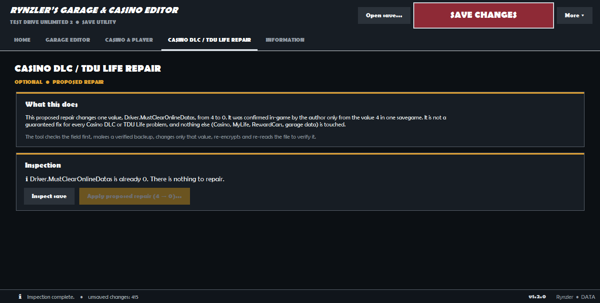
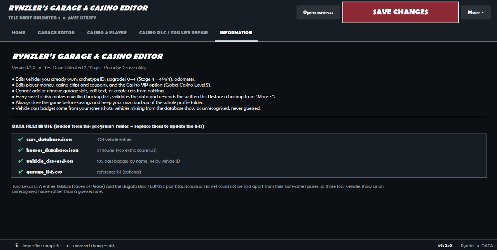
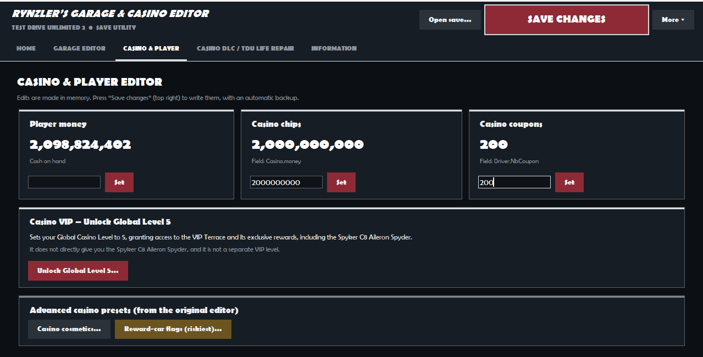
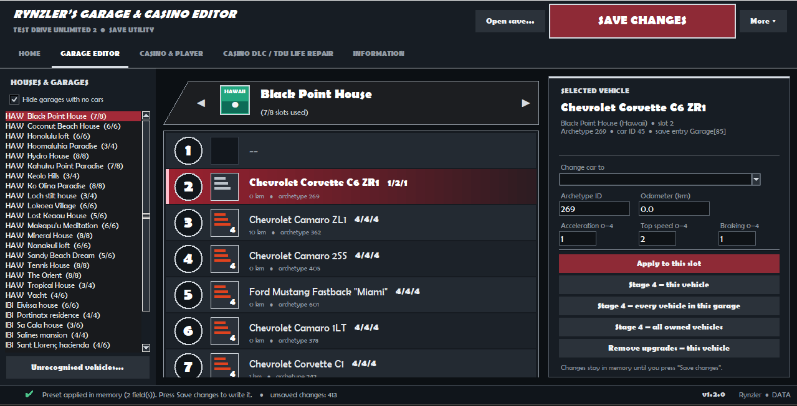

Rynzler’s Garage & Casino Editor

Free Test Drive Unlimited 2 Save Editor

After many hours of development, testing and refinement, I’m pleased to share Rynzler’s Garage & Casino Editor — a free save-editing tool created for the Test Drive Unlimited 2 community.

Whether you’re returning to TDU2 for another playthrough, managing a large collection of vehicles, or wanting to revisit Casino content that is no longer easily accessible, this editor gives you a straightforward way to make selected changes to your existing save.

It has been developed with TDU2 and Project Paradise 2 players in mind, with a focus on useful features, straightforward operation and protecting your existing progress.

## Screenshots

### Screenshot 1

### Screenshot 2

### Screenshot 3

### Screenshot 4
⸻

FREE DOWNLOAD — NO SUBSCRIPTION OR PAYMENT REQUIRED

I’ve put a considerable amount of time into developing and testing this tool, and I’m happy to make it available to other players completely free of charge.

The editor is designed to make targeted changes to selected save-data values rather than unnecessarily rewriting unrelated career progress.

It includes automatic backups, save validation, verification and a restore option. Nevertheless, you should always keep your own backup of your original save.

⸻

WHY I MADE IT

TDU2 is a fantastic game, but starting another playthrough or unlocking certain content can involve a considerable amount of time.

The Casino is a good example. Some of its original online progression is no longer available in the same way it once was, making certain rewards and features difficult to access.

I wanted to create something that allows players to spend less time repeating old progression and more time enjoying the cars, garages and content that make TDU2 special.

The editor is not intended to replace the game or automatically complete an entire career. It provides selected tools for players who want more control over their existing save.

⸻

FEATURES

Garage Editor

* Browse owned vehicles organised by house, island and garage slot.
* View vehicle names, archetype IDs, mileage and upgrade information.
* Change a vehicle in an existing garage slot using a recognised vehicle archetype ID.
* Apply Stage 4 upgrades (4/4/4) to an individual vehicle.
* Apply Stage 4 upgrades to every vehicle in a selected garage.
* Apply Stage 4 upgrades to all owned vehicles.
* Remove upgrades from an individual vehicle.
* Edit individual vehicle mileage/odometer readings.

Casino & Player Editor

* Set Global Casino Level to 5 to unlock access to the VIP Terrace.
* Edit player money.
* Edit Casino chips.
* Edit Casino coupons.
* Apply the available Casino cosmetics preset.
* Apply the available reward-car flags preset (advanced/riskier option).

Casino VIP clarification: The Global Level 5 option unlocks VIP Terrace access and the associated VIP progression. It does not directly place the Spyker C8 Aileron Spyder in your garage.

Save Protection & Verification

* Automatic verified backup before writing changes.
* Save-data validation before changes are committed.
* Re-read and verification of the saved file.
* Automatic rollback if a write or verification fails.
* Restore an earlier backup from within the application.
* Save changes to a separate file instead of overwriting the original.
* Verify an existing save file from the application.

Optional Casino DLC / TDU Life Repair

An additional targeted repair option is included for a specific save-data issue involving Driver.MustClearOnlineDatas.

The repair checks for the exact value it is designed to address (4), creates a backup, changes that value to 0 and verifies the result.

This option helped address missing Casino access / Casino DLC / TDU Life problems in the author’s testing, but it is not a universal fix and should only be used when the relevant issue is present.

⸻

VEHICLE DATABASES & MOD SUPPORT

The editor includes an extensive vehicle database containing 424 entries, along with house information and vehicle class data.

It also includes a reference list of the author’s 206 owned vehicles, which can be opened from the application’s More menu.

A note about unofficial patches and mods

TDU2 has a wide range of unofficial patches, additional vehicles and modifications, including content from the Unbounded Mod.

Not every vehicle from every external modification is currently identified or mapped. Some vehicle names, archetype IDs, house assignments and class information may therefore be missing or displayed as unrecognised.

The current class database confirms classes for 100 of the author’s 206 owned vehicles. The remaining vehicles have deliberately been left without a class where reliable information was not available, rather than assigning potentially incorrect information.

The vehicle and house databases can be updated separately without changing the main application, allowing further improvements to be made as additional information becomes available.

The editor works with existing garage entries; it cannot create additional garage slots or generate vehicles that are not already represented in the save.

⸻

COMMUNITY CONTRIBUTIONS – HELP MAKE THIS BETTER!

This is a free community project, and I’d genuinely love to see other TDU2 players get involved in improving it.

In particular, I’m looking for help identifying additional vehicles from the Unbounded Mod and other unofficial modifications.

There are currently vehicles whose inbound vehicle IDs, names and other information I haven’t been able to identify reliably.

If you have experience with Unbounded Mod, understand vehicle archetype IDs, or have access to information that could help expand the database, your contribution would be hugely appreciated.

Some of the things I’d particularly welcome help with:

* Identifying unknown inbound vehicle IDs.
* Adding Unbounded Mod vehicles to the vehicle database.
* Confirming vehicle names against their correct IDs.
* Identifying missing or incorrect house assignments.
* Confirming vehicle classes where reliable information is available.
* Reporting bugs, errors or unexpected behaviour.
* Suggesting improvements or helping develop additional features.

If you discover an unknown vehicle ID, please include the vehicle name, its inbound vehicle ID, the mod or game version you’re using and, ideally, a screenshot or other evidence.

Bug reports are equally welcome. If something doesn’t work as expected, please let me know. Screenshots, error messages and steps to reproduce the problem will make it much easier to investigate and fix.

You don’t need to be a programmer to contribute. Even helping identify a handful of missing vehicles could make a real difference.

The aim is to build a more complete and reliable vehicle database together, and make the editor as useful as possible for the TDU2 community.

You can submit discoveries, bug reports and suggestions through the GitHub Issues section of this project.

Thank you to anyone willing to help!

⸻

SAVE GAME SAFETY

Protecting existing save data has been an important part of this project.

The editor is designed to change only the selected values and preserve unrelated save data wherever possible. Its save process validates the data, creates a verified backup, writes the updated file and then checks the result.

The application also provides a restore option and the ability to save changes as a new file.

The development build was tested against copies of the author’s save, with comparisons against the original editor and checks to confirm that unrelated data remained unchanged.

No save editor can guarantee compatibility with every modified save, unofficial patch or future game update. Always make your own backup of your complete TDU2 profile before editing. 

⸻

DOWNLOAD & INSTALLATION

The editor is completely free to download and use.

It is supplied as a ZIP containing the application and its supporting databases.

You will need:

* Windows.
* Python 3.8 or newer, with Tkinter included (the standard option in the official Python installer).

No additional Python packages are required.

Extract the complete ZIP, keep all the files together and launch the application using the included .bat file.

A first-time installation and usage guide is provided alongside the download.

⸻

A FINAL NOTE

This project has taken many hours of work, testing and refinement, and I’m genuinely pleased to be able to share it with the TDU2 community.

It is still an evolving project. Vehicle databases and class information can be improved as more information becomes available, particularly for cars introduced through unofficial patches and external modifications.

I’m particularly keen to expand support for Unbounded Mod vehicles and welcome anyone who can help identify missing inbound vehicle IDs or improve the existing database.

Whether you’re returning to Ibiza and Hawaii, organising your garage, revisiting Casino content or simply making a few adjustments to your existing save, I hope this tool makes your time in TDU2 a little more enjoyable.

Free to use. Made for the community. Improved by the community.

Enjoy!

— Rynzler
